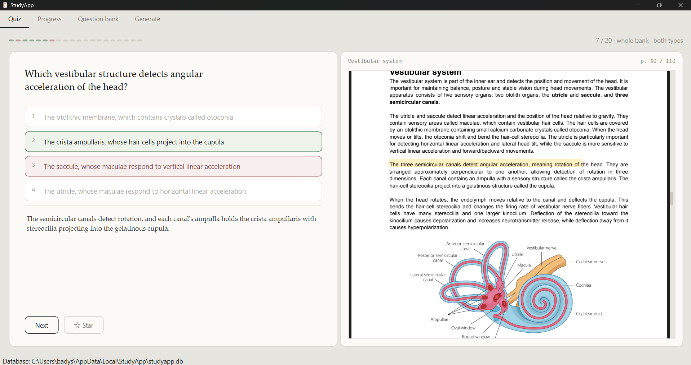
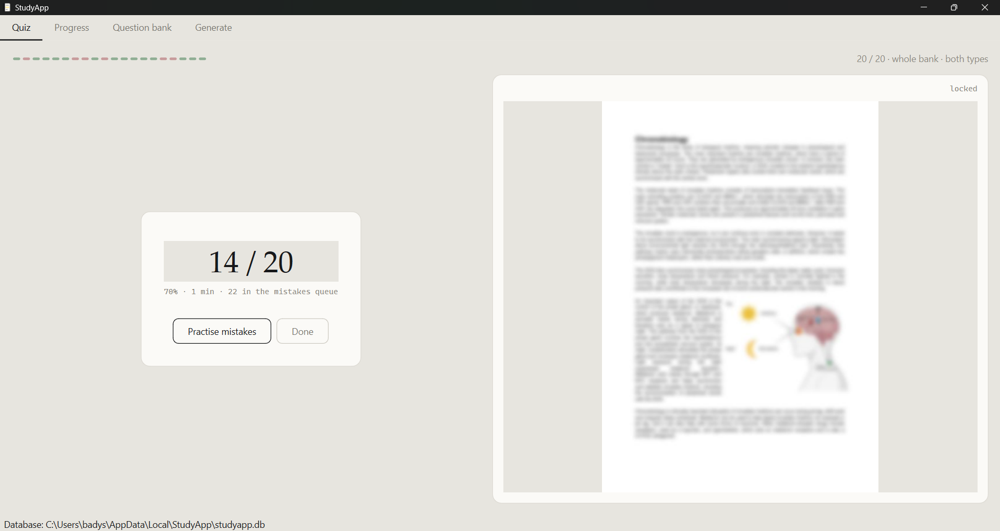
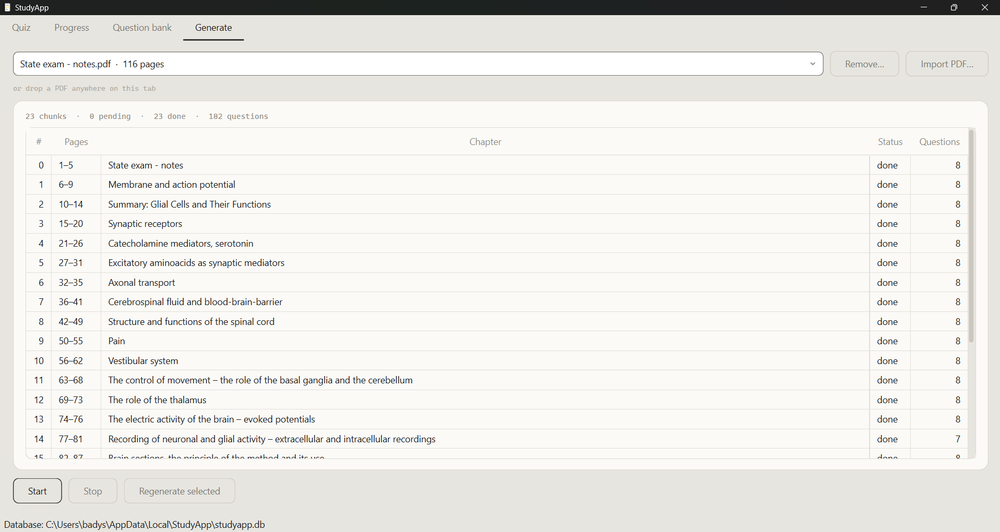
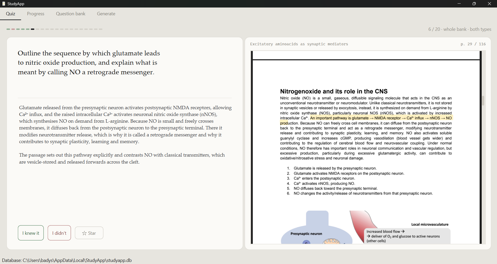

# StudyApp

[](https://github.com/BadyTM/studyapp/actions/workflows/tests.yml)

By Miroslav Kalenský.

A desktop quiz trainer built from one PDF of study material. Claude reads the book
once and writes the question bank; after that the app runs offline, and every question
it asks can point at the sentence in the PDF the answer came from.

The interface is English. The questions are in the language of the source book, and the
quoted sentence is always the book's own words, untranslated.

*Built with AI assistance (Claude Code).*

## What it does

The practice view is split down the middle: the question on the left, the page of the
book it came from on the right, blurred. You can see that the answer is *there*, on a
real page, without being able to read it. Answering unblurs the page, scrolls to the
right spot and paints a marker over the sentence. Over a few hundred questions that turns
into a sense of where things are in the book, which a flashcard deck does not give you.



There is no skip. `Reveal` is the only way forward, which is what stops a session turning
into a list to browse rather than a test to sit.



## The pipeline

    import      PDF -> pages -> chunks of ~1500-2500 words, broken on chapter headings
    generate    one API call per chunk -> questions, each with a verbatim quote
    validate    the quote is found in the chunk, or the question does not exist
    locate      the quote is searched for in the PDF -> the page and the highlight boxes
    dedupe      a separate CLI retires questions that ask the same thing twice
    practise    offline, from SQLite

The middle three are the whole design. The model returns a question and a `source_quote`
it claims to have copied out of the passage; nothing else it says about where the answer
came from is believed. The quote is checked against the chunk, then searched for in the
PDF with PyMuPDF, and the page number and the highlight rectangles both fall out of that
one search. The model never sees a page number and is never asked for one.



## Running it

Requires **Python 3.11+** by syntax, built and tested on 3.13, on Windows.

```powershell
python -m venv .venv
.venv\Scripts\python.exe -m pip install -r requirements.txt
```

    StudyApp.pyw                             double-click, no console window
    python -m studyapp                       the same window, with a console for tracebacks
    python -m studyapp.ingest <pdf>          extract, chunk and store a PDF
    python -m studyapp.generate --limit 5    the generation pilot, for tuning the prompt
    pytest tests/                            the tests (pip install pytest first)

The launcher looks for the interpreter in `STUDYAPP_VENV`, then `.venv` beside the
project, then `%LOCALAPPDATA%\StudyApp\venv` — double-clicking a `.pyw` hands it to the
*system* `pythonw.exe`, which has no PySide6, so the first thing it does is hand itself
over to the right one. Keeping the environment outside the project is not a detail here:
PySide6 alone is some 350 MB and this project sits inside OneDrive.

The database and the render cache live in `%LOCALAPPDATA%\StudyApp`, never in the project
folder, for the same reason — OneDrive syncing a WAL-mode SQLite file mid-write is a
reliable way to lose it. `STUDYAPP_DB` overrides the location.

### Two ways to pay for the generation

| | subscription | API credit |
|---|---|---|
| needs | [Claude Code](https://claude.com/claude-code) (`npm install -g @anthropic-ai/claude-code`) | `ANTHROPIC_API_KEY`, or the key in the OS credential store |
| class | `ClaudeCodeBackend` | `ApiBackend` |

`config.BACKEND` decides: `"auto"` (the default) tries the subscription first and falls
back to the API key. Both return the same list of raw question dictionaries, so
validation cannot tell them apart. The key is read through `keyring`, never from
QSettings, which is a plaintext INI file in the user's profile.

Only generation costs anything. Practising needs neither the network nor a key.

## Managing the bank

The **Question bank** tab opens on the whole active bank, filtered from its own header:
the combo under `Type` filters by type, the one under `Chapter` by chapter, the box under
`Question` searches question, answer, options and explanation, and the box under `Star`
narrows to starred. Columns with nothing to filter — `Page`, `Score` — have no control,
and the gap says so.

Above the table sits what acts on a whole document rather than on selected rows:

    All documents ▾   which book the table, the counts and the chapter filter are about
    Locate PDF…       appears when the chosen document's file is not where it was
    Export… Import…   the JSON described below
    Remove…           deletes the document, its questions and their answers
    Active ▾          which slice of the bank is on screen: active, retired, needs review

`Remove…` is the only control in the app that destroys a bank, so it counts out what goes
before asking and is offered for one chosen document, never for "All documents". It does
not touch the PDF on disk — only what StudyApp generated from it. It is a different thing
from `Remove…` on the Generate tab, which merely takes a document out of the generation
list and leaves every question where it is.

The **Progress** tab carries the same picker. Two books used to share one accuracy
figure and one chapter table, which made both useless: a chapter sitting at 40% is the
whole reason the table exists, and it cannot be seen through the average of a book that
is going fine.

## Sharing a bank

Questions move between copies of StudyApp as one JSON file, from the **Question bank**
tab. The document picker decides what travels: one book, or all of them.

    Export…     writes the questions, their chunks and the passages they came from
    Import…     adds whatever this bank does not already have

Three things are deliberately not in that file. **The PDF**, because a page number and a
highlight rectangle mean nothing without the exact file they were found in — the export
stores its SHA-256 so the far side can check it has the right one, and says which
documents still need theirs. **Attempts and sessions**, because practice is personal and
the bank is not. **Embeddings**, because they are a cache `embed/dedupe.py` can rebuild.

So a bank handed to someone else arrives in two pieces, and the app walks through them:

1. *Import…* the JSON — the questions are there, and the quiz runs
2. the source pane says the file is missing, so *Locate PDF* and point at it; the hash
   has to match, which is what stops a different edition quietly answering for it
3. the blurred pages render themselves, once

Importing is additive and safe to repeat: it matches documents by PDF hash, chunks by
text hash and questions by wording, so nothing is duplicated and nothing of yours is
overwritten. Two people who generated from the same book can merge their banks by
swapping exports.

## Revealed and solved problems

**A model asked where a fact came from will tell you, and be wrong.** The obvious design
takes the page number from the reply. It comes back plausible, confidently given and
sometimes off by a chapter, and there is no way to notice at a glance. The constraint is
structural instead: the model is told it will not see page numbers and is not asked for
one. It returns `source_quote`, a literal run of the passage, and `rects.py` searches the
PDF for it. A page number arrived at by finding the text cannot be invented, and the same
search produces the highlight rectangles, so the two can never disagree.

That only works if the quote really is a quote, which is what `validate.py` is for. A
quote the model has tidied up — a comma, an accent, collapsed whitespace — still passes
at a 0.9 similarity threshold; one it has rewritten does not, and one it has translated
into the language of the question fails outright. Every rejection carries a reason,
because the reasons in aggregate are how the prompt gets fixed: forty questions lost to
`translated_quote` says something entirely different from forty lost to
`correct_not_in_options`.

**The right answer was the longest option 58% of the time.** Against 25% by chance —
which meant a reader could score 58% by picking the longest option and reading none of
the material. The cause was not carelessness: stating the true option carefully and in
full, then writing three false ones tersely, is what writing questions naturally does.
The prompt now says to read the four back side by side before finishing.

The other giveaway is subtler. The quickest way to write a false option is to overstate a
true one — "has no role at all", "only X does this" — so "always", "never", "only", "all"
and "none" end up living almost entirely in the wrong answers, and the reader learns to
cross out whichever option sounds absolute. That rule works without knowing any of the
subject. Distractors are now made wrong by substituting a specific fact instead: the
neighbouring structure, the opposite direction, the other transmitter.

**Two thousand words of neurophysiology beat the output contract.** On the subscription
path there is no tool schema — the CLI cannot be given a custom tool — so the reply has
to be JSON in prose, and the rules for it were in the system prompt. By the time the
model had read the passage it had reverted to what "write exam questions" usually means:
a markdown exam paper, then JSON in its own vocabulary — `multiple_choice`, `marks`,
`difficulty`, options keyed by letter, and 23 questions where 8 were asked for. The
contract is now repeated *after* the passage, where nothing comes between it and the
reply. Repetition in a prompt is not redundancy when the thing being repeated has already
been overridden once.

A related bug was shorter and worse: the shared prompt ended with "return everything
through the `save_questions` tool" on both paths. On the CLI, where that tool does not
exist, the model was being pointed at nothing — and duly ignored the instruction
altogether and wrote prose.

**Three ways to be confidently wrong about one sentence.** The quote is matched
case-insensitively, and `str.casefold()` is not length-preserving: `fi` folds to two
characters, `ß` to `ss`. A position found in the folded text does not index the unfolded
text, so every ligature before a match slid the stored quote along by one — `Atomicita`
came out as `tomicita`, with a score of 1.00 and nothing to suggest it was wrong.
Ligatures are ordinary in typeset PDFs, so this was most of a well-set book.

Then the marker. `search_for(quote[:80])` was the quickest way to find out which page
held the quote, and it was also what painted the highlight — so a 200-character quote was
marked for its first eighty characters and stopped, mid-word. Measured over a real bank,
176 questions out of 180.

And the page. `locate` took the first page in the chunk that answered at all, so a
six-word opening on an earlier page — a chapter recap repeating the sentence's first
words — stole the page number from the page that actually held the quote. The worst case
is a negated near-duplicate: it scores 0.94 against the real sentence on text alone, and
the marker lands on a sentence asserting the opposite of the answer. Every page in the
chunk is now scored and the best one wins; the word match comes first and the prefix
search is the fallback, not the other way round.

**Blurring the page live flickers, and the metadata gives the answer away anyway.** A
`QGraphicsBlurEffect` over a scrolling `QPdfView` repaints the blur on every scroll step
and looks it. Every page is now blurred once at import time and displayed as a plain
image; revealing is a switch between two layers of a `QStackedWidget`, which is instant
and cannot flicker. It also means the running app never opens the PDF with PyMuPDF at
all, so two PDF engines are never resident in one process.

The blurred render is deliberately *smaller* than it is displayed, at 0.8 zoom, which
sounds wrong and is not: the blur destroys exactly the detail the extra resolution would
have carried. Measured against a 1.5x render, the displayed result differs by 0.6% per
pixel while taking a tenth of the time and an eighth of the space — for 200 pages, 8
seconds and 4 MB instead of 80 seconds and 32 MB.

Hiding the words turned out not to be enough. A page number or a chapter title in the
strip above the page answers plenty of questions by itself, so both are withheld until
the reveal — and the blurred pane deliberately shows *the previous question's page*
rather than the one coming. Watching the pane now tells you nothing before you have
answered.

**`database is locked` is a design error that arrives looking like bad luck.** Generation
runs four chunks at a time. A `sqlite3` connection cannot be shared between threads, and
four workers each opening their own and inserting produces lock errors
non-deterministically — which is the worst way for a bug to present, because it looks
like a flaky machine rather than something you did. So the rule is that **workers compute
and one thread writes**: a `ChunkJob` does the network call, the validation and the
rectangle search, and then does nothing with the answer except emit it. The controller
lives in the GUI thread and is the only thing in the program that writes during a run.

The cancel path is the same rule seen from the other side. A cancelled job still has to
report back — the controller ends a run by counting results against the number of chunks
it queued, so a job that returns in silence leaves it waiting forever for a result that
is never coming, and `Start` never comes back.

**PyTorch must never reach the application.** Deduplication compares every question
against every other one, which wants sentence embeddings, which wants
`sentence-transformers`, which drags in some two gigabytes of PyTorch. It runs as its own
CLI in its own virtualenv; `encode.py` imports the model inside the functions rather than
at module level, and the vector maths in `dedupe.py` needs nothing heavier than numpy —
one matrix multiply against the whole bank, a few milliseconds at a thousand questions.
A test called `TestNoTorchAnywhere` is what keeps it out.

**A bank is not a file you can copy.** The first way to share one was to send the
database: `VACUUM INTO` to fold in the WAL, the PDF alongside it, the lot in a zip. It
worked and it could not merge. The recipient either kept their own bank or kept yours,
because a database arriving as a file has no way to join what is already there — and the
instructions said as much, in the sentence asking them to rename their old one first.

So questions travel as JSON now, through **Export…** and **Import…** on the Question bank
tab, and the importer decides what to do with them. It matches on content, never on row
ids, which belong to the database they came from: a document is the same document when
its PDF hashes the same, a chunk when its text does, a question when it reads the same
within that chunk. Nothing is overwritten and nothing is deleted, so importing the same
file twice is a no-op — which matters, because the obvious way to check an import worked
is to do it again.

What does not travel is the PDF. Every question carries a page number and a rectangle on
that page, and both are meaningless without the file they were found in, so the export
records its SHA-256 instead and the import says which documents still need theirs.
Pointing the app at the file is the same *Locate PDF* the tab already offers, and the
blurred pages render themselves afterwards. Attempts stay behind too: practice is
personal, the bank is not.

## Layout

Everything you double-click sits at the top; the code lives one level down.

    StudyApp.pyw               what you double-click
    assets/                    the icon: the window, the taskbar and the shell all use it
    docs/                      the build plan and the design mock-ups
    studyapp/                  the code
    tests/

### studyapp/

    config.py               paths, model, thresholds, where the API key comes from
    main.py                 starts the application

    ingest/     extract.py      text and typographic lines, per page
                chunker.py      pages -> chunks, broken on chapter headings
                language.py     what language the book is in, by counting function words
                blur.py         every page pre-rendered blurred, once
                importer.py     prepare (slow, no database) / store (writes, GUI thread)

    generate/   prompts.py      the system prompt and the tool the model answers through
                client.py       ApiBackend and ClaudeCodeBackend, one interface, costs
                validate.py     the gate every question passes through
                rects.py        finds the quote in the PDF -> page + highlight boxes
                pipeline.py     one chunk in, database-ready questions out
                worker.py       the thread pool, and the one thread that writes

    quiz/       session.py      one session: what may be advanced past, what gets written

    db/         connection.py   WAL, busy timeout, foreign keys -- on every connection
                repo.py         every query in the application
                transfer.py     a bank in and out as JSON, matched on content
                migrations/     Alembic, written by hand

    embed/      encode.py       question text -> vectors, model imported inside functions
                dedupe.py       cosine similarity over the bank, numpy only

    ui/         main_window.py  two tabs: practise and generate
                quiz_view.py    the question and the book, side by side
                pdf_view.py     the two-layer source pane
                highlight.py    the marker over the quote, painted by hand
                bank_view.py    find a question, fix it, retire it, send it on
                generate_view.py   import, run, watch, resume
                stats_view.py   overall, by chapter, session by session
                style.py        the palette and the stylesheet
                session_header.py, tables.py, cursors.py, models.py

`ui/` holds widgets and signals and no business logic; every query in the program is in
`db/repo.py`. Both rules exist so the schema stays changeable: when a column moves, one
file follows it.

Two of Qt's own gaps are papered over in `ui/`, and the comments there say why. Stylesheets
have no `cursor` property — it is accepted and ignored — so the pointing hand is set by one
application-wide filter rather than on each widget by hand. And `QTableView::item:hover` is
a rule about one cell, so a hovered *row* has to be tracked by the view and painted by a
delegate.

## The database

Five tables — `documents`, `chunks`, `questions`, `sessions`, `attempts` — and the binding
definition is always the newest Alembic migration in `studyapp/db/migrations/versions/`,
not the plan document. Migrations are written by hand: without SQLAlchemy models,
`--autogenerate` has nothing to compare against.

Three columns carry most of the design:

- `questions.source_quote` is verbatim source text and is never edited, translated or
  regenerated. The page number, the highlight and the reader's trust that the answer is
  really in the book all rest on it.
- `questions.page` is computed from where that quote was found, never taken from a reply.
- `questions.is_active` is how a question goes away. Nothing is deleted, because
  `attempts` reference questions, and a bank that forgets what you answered is worse than
  a bank with a bad question in it.

`chunks.status` is tracked per chunk (`pending | running | done | skipped | failed`),
which is what makes a run interruptible: close the window half way through a book and it
resumes where it stopped, or regenerates one chapter without touching the rest.
`questions.edited_at` protects anything you have corrected by hand from a regeneration.

Every connection sets WAL, a busy timeout and `PRAGMA foreign_keys=ON` — all three are
per-connection rather than stored in the file, and without the third the `REFERENCES`
clauses are decoration.

## Tests

    pip install pytest
    pytest tests/          689 tests

No tokens are spent: both backends are faked. The widget tests run on Qt's offscreen
platform, set in `conftest.py` before anything imports Qt, so the whole suite runs
headless — which is what CI runs on every push.

`validate.py` is the most heavily tested file in the project, deliberately: it is the only
thing standing between the model and the question bank. Its fixtures are real replies — a
clean one, a paraphrased quote, a translated quote, a `correct` that names no option —
kept in `tests/fixtures/replies/`.

## Limitations

- **Windows in practice.** The launcher, the taskbar app id and the credential store are
  Windows-specific. `config.py` handles macOS and Linux paths, but nothing else there has
  been run.
- **A chunk is named after the chapter it opens under, not every chapter it holds.**
  Chunks are broken on chapter headings, but only once they are worth generating
  from (`CHUNK_MIN_WORDS`, 1500), so a heading that arrives earlier than that is
  swallowed. On a book of one-page topics that is most of them: 22 of the 23 chunks
  of the book this was built against hold one to four further chapters. The
  questions are unaffected -- the chunk text, the quote, the page and the highlight
  are all right -- but the `Chapter` column, the chapter filter and the per-chapter
  accuracy name only the first of them. Lowering `CHUNK_MIN_WORDS` tracks the
  headings more closely at the cost of more API calls and less context per question.
- `docs/` is in Czech: it is the build plan and the design mock-ups the app was
  written from, kept as they were written. The code and this README are English.
- Statistics are counted over every attempt, not the newest one per question. A chapter
  answered wrong three times and right once reads as 25%, which is the point — it is the
  chapter to go back to — but it is not "how well do I know this now".
- The dollar figures are constants in `generate/client.py` and go stale whenever Anthropic
  changes its prices.
- `ui/quiz_view.py` is 819 lines and wants splitting; `ui/bank_view.py` is close behind at 874.
- Open questions are self-graded. You are shown the model answer and say whether you had
  it — honest enough alone, worth nothing as a shared score.

  
- Generating a 200-page book is one long run, measured in hours and in real money. Tune
  the prompt with `python -m studyapp.generate --limit 5 --dry-run` first.

## License

This project's own code is MIT — see `LICENSE`.

Its dependencies are not all permissive, and two are worth knowing about before you
build anything distributable from this:

| | license | matters because |
|---|---|---|
| **PyMuPDF** | AGPL-3.0, or a commercial licence from Artifex | strong copyleft; it reaches the combined work |
| **PySide6 / Qt** | LGPL-3.0 | relinking must stay possible for whoever you give it to |
| anthropic, alembic, keyring, numpy, pillow | MIT / BSD / HPND | permissive |

Publishing this repository is unaffected: what is distributed here is StudyApp's own
source, and PyMuPDF arrives on your machine from PyPI under its own terms. Sharing a
question bank is clear too — an export is JSON, and carries no code at all.

The line to watch is a frozen build. A PyInstaller `.exe` would embed both PyMuPDF and
Qt, and at that point the AGPL attaches to the whole bundle and Qt's LGPL relinking
requirement attaches to the Qt part. If that is ever the goal, the choices are to licence
the result AGPL-3.0, buy an Artifex licence, or replace PyMuPDF — it is used in
`ingest/extract.py`, `ingest/blur.py` and `generate/rects.py`, and `pypdfium2`
(BSD/Apache) covers the same ground.
